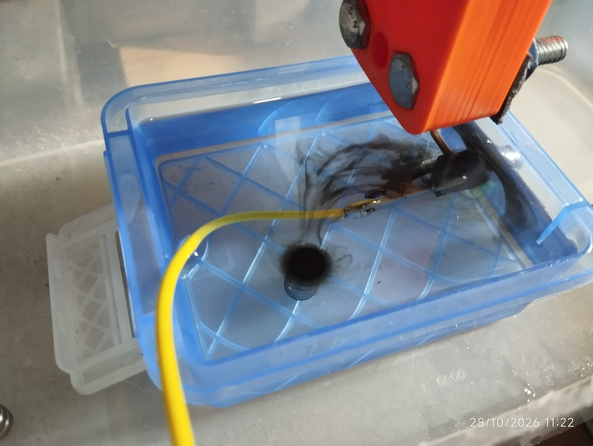
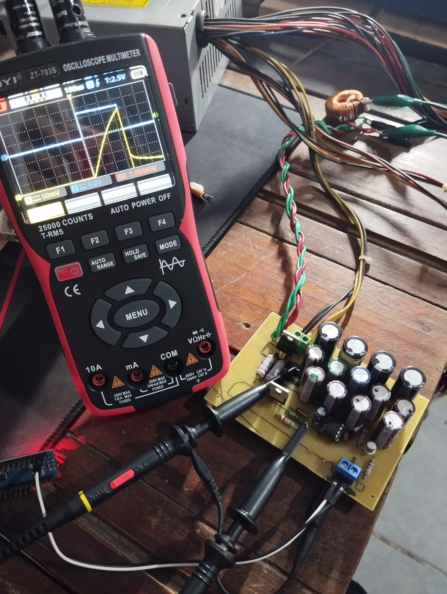

# EBER FLORES
## Mechanical Engineer · Embedded Systems & Industrial Data

**I turn engineering ideas into working systems.**

---

## 🚀 Featured projects

<table>
  <tr>
    <td width="50%" align="center">
      
      <h3>⚡ STM32-Based Sinker EDM</h3>
      
Custom electrical discharge machine: power electronics, embedded control, custom PCBs and mechanical fabrication.

      <a href="https://foreber-v2.github.io/stm32-sinker-edm/"><b>Project page</b></a> ·
      <a href="https://github.com/foreber-v2/stm32-sinker-edm">Source code</a>
    </td>
    <td width="50%" align="center">
      
      <h3>📏 Inductance Meter</h3>
      
Redesigned measurement instrument: new schematic, custom PCB, fabrication and experimental validation.

      <a href="https://github.com/foreber-v2/Inductance-Meter-Custom-Hardware"><b>View project</b></a>
    </td>
  </tr>
</table>

---

## 🔧 What I work on

| | Area | Focus |
|---|---|---|
| ⚙️ | **Mechanical** | Prototyping, fabrication, equipment modification |
| ⚡ | **Electronics** | Circuit design, PCBs, measurement systems, power electronics |
| 💻 | **Embedded** | STM32, C, peripherals, real-time control |
| 📊 | **Industrial data** | Python, SQL, Power BI, Power Query |
| 📱 | **Software** | Kotlin, Android, Jetpack, MVVM, Room |

## 🧰 Tools

## 📚 Background

- Mechanical Engineering graduate
- Completed Harvard's CS50
- Completed Microsoft Certified: Power BI Data Analyst Associate course
- Self-directed projects in hardware design, programming, fabrication and system integration

## 📬 Let's work together

Open to engineering roles, freelance projects and collaboration.

**Email:** [contacto@solucionesdedalo.com](mailto:contacto@solucionesdedalo.com) · **Web:** [solucionesdedalo.com](https://solucionesdedalo.com) · **LinkedIn:** [Eber Flores](https://www.linkedin.com/in/eberflores/)

This portfolio documents personal engineering projects. Each project page separates completed functionality from planned improvements.
